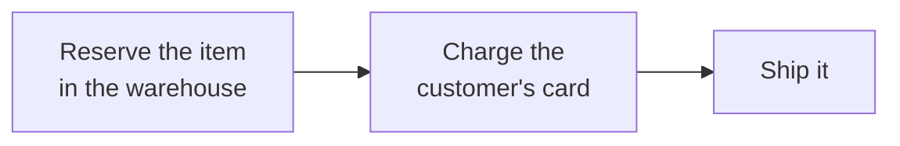

# 1.1 A program is a list of steps

**Time:** 10 minutes

## An online order, step by step

When you buy something online, a program on the store's side does roughly this:



Each box is a **step**, and each step talks to a different system: the warehouse's inventory system, a payment provider like Stripe, a shipping carrier. Written as code it's three lines:

```ts
await inventory.reserve(orderId, "SKU-42");
await bank.charge(orderId, 4999);
await shipping.ship(orderId, "123 Main St, Bozeman MT");
```

## Side effects

Each of those steps changes something **outside the program**: an item is held, money moves, a box gets a label. These changes are called **side effects**, and they're the whole point. A checkout that didn't charge or ship anything would be useless.

Side effects have one property that makes everything in this course hard:

> **A side effect can't be taken back just by stopping the program.**

If the program stops after the charge, the money has still moved. Undoing it takes *another* side effect (a refund), which is another step that can also fail.

## Inside the program vs. outside

| Inside the program (memory) | Outside the program (the world) |
| --- | --- |
| Variables like `orderId`, `paymentId` | The bank's record of the charge |
| Which line it's currently on | The warehouse's reservation |
| Gone the instant the program stops | Stays forever |

That mismatch is the root of the problem. The *knowledge* of what happened lives in memory, which is fragile. The *consequences* live outside, which is permanent. When the program dies, it forgets what it did but the world doesn't.

## Real processes are longer

Three steps is a toy example. Real ones look like:

- **Subscription billing:** charge → wait 30 days → charge again → if it fails, retry in 3 days → email → retry in 7 days → cancel
- **Loan application:** collect documents → credit check → wait for an underwriter's approval (could be days) → sign → fund
- **AI agent:** ask the model → call a tool → ask the model again → call another tool → … (dozens of steps, each costing money)

More steps, longer waits and more outside systems mean more places to fail halfway.

> **▶ Run it**
> ```bash
> npm run m1
> ```
> This module's demo covers lessons 1.1–1.4. Scenario 1 is the happy path: three steps, nothing goes wrong. Keep it running and read lesson 1.2 alongside scenario 2.
