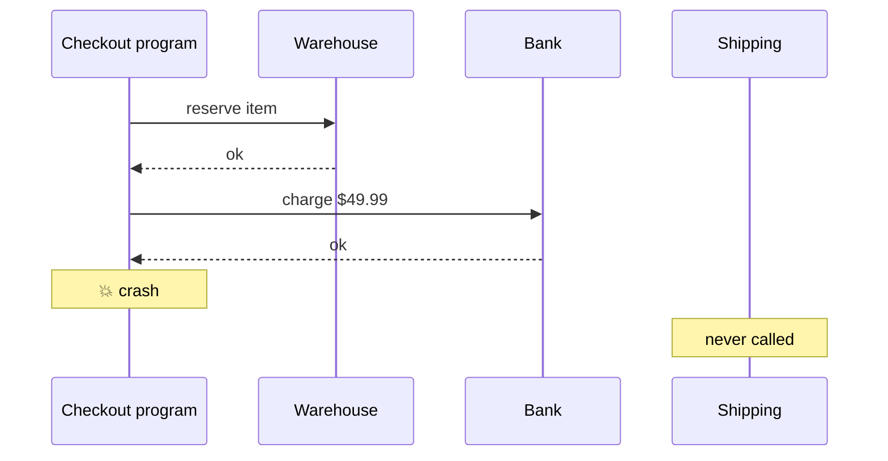
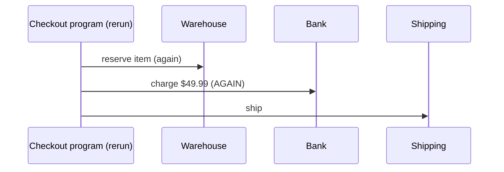

# 1.2 Failure happens in the middle

**Time:** 15 minutes

## Things that stop programs

Programs stop unexpectedly all the time, and usually not because of a bug in the program itself:

- **Deploys.** Shipping new code means stopping the old version. Many companies deploy dozens of times a day.
- **Crashes.** Running out of memory, a bug in a library, a bad input.
- **Infrastructure.** A server is replaced, a cloud zone has an outage, a container platform like Kubernetes moves the program to another machine.
- **Timeouts.** Serverless platforms (AWS Lambda and others) kill any program that runs longer than a limit, often 15 minutes.

At scale this isn't rare. A company processing a million orders a day *will* have orders in flight every time any of the above happens.

## The half-finished order

<!-- widget: sim {"mode":"plain","scenario":"crash-after-charge"} -->

Here's the crash from scenario 2 of the demo:

The order is now **half done**: the customer paid, the item is reserved, and nothing will ship. The program isn't running, so nothing will notice or fix it.

This is called **partial failure**: some steps happened, some didn't, and the system is in a state nobody designed for.

## Can't we just run it again?

The obvious fix is to rerun the checkout. But the program has no memory of the previous run. It starts from line one:

The item ships, but the customer is charged twice. Rerunning fixed one problem by creating another.

What we'd really want is for the rerun to **know how far the last run got** and pick up from there. Hold that thought: it's the core idea of Module 2.

## The two bad options

When a multi-step process fails halfway, without special tooling you get to choose between:

| Option | Risk |
| --- | --- |
| **Rerun from the start** | Steps that already happened happen again (double charge, two shipments, duplicate emails) |
| **Don't rerun** | Work is left half done (customer charged, nothing shipped) |

Neither is acceptable, and that's why companies build elaborate machinery to cope (lesson 1.5).

> **🎧 Support angle**
> "We had an outage and now some orders are stuck" and "some customers got charged twice" are among the most common tickets in this product category. They're usually the same root cause, partial failure, handled in one of the two bad ways above.
