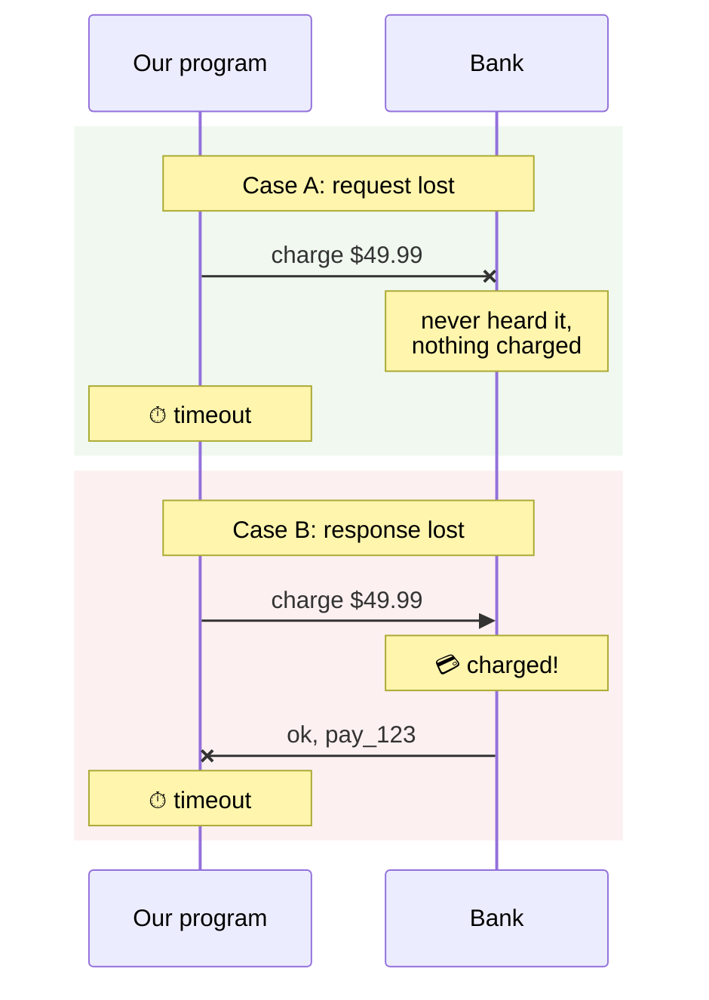

# 1.3 The ambiguous failure

**Time:** 15 minutes

This lesson covers the single most important idea in the course. It's subtle, so take it slowly.

## Asking and answering are separate events

When our program charges a card, two separate messages travel over the network:

1. **The request:** "please charge $49.99"
2. **The response:** "done, payment id pay_123"

Either one can be lost: a network blip, an overloaded server, a timeout. And the program can't tell which was lost.

From the program's point of view, **both cases look identical**: it sent a request and got a timeout. But in case A nothing happened, and in case B the customer was charged.

This is called an **ambiguous failure**. An error *after* sending a request doesn't mean the request failed. It means **you don't know**.

## Why you can't just check

"Ask the bank whether it charged" sounds like a fix. But that question is also a request over the same network, and its answer can get lost too. You can reduce the uncertainty, but you can't build a program that is always certain about what happened on the other side of a network.

Computer scientists proved this decades ago (look up the "Two Generals' Problem" if you're curious). The practical takeaway is simpler:

> **Any step that talks to another system can fail in a way where you can't tell whether it happened.**

## In the demo

Scenario 3 of `npm run m1` makes the bank lose its reply on purpose. The program prints an error, and the ledger shows the customer **was** charged. If you were the support engineer and the customer's logs said "charge failed," you'd tell them they weren't charged, and you'd be wrong.

> **🎧 Support angle**
> Never conclude "the step didn't happen" from an error message alone. Check the **system of record**: the payment provider's dashboard, the warehouse's database, the email provider's logs. This habit will save you from giving customers confidently wrong answers.

## Where this leaves us

Ambiguous failures mean that even a perfect record of "what our program did" can't tell us what the outside world did. Durable execution helps a lot here, but **it can't eliminate ambiguity on its own**. It needs help from the outside systems, through **idempotency keys** (lesson 2.5). Keep this lesson in mind; it comes back in every module.
