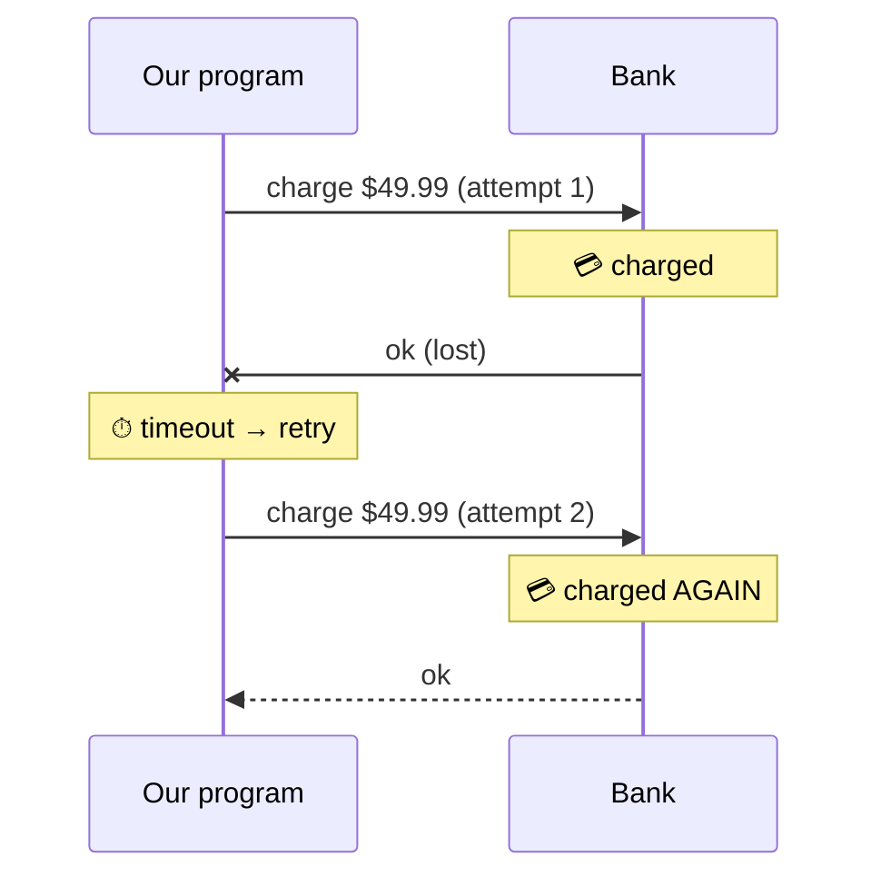

# 1.4 Why "just retry" backfires

**Time:** 10 minutes

## Retries are necessary

Most failures between systems are **transient**: they go away if you wait a moment and try again. A server was restarting, a network link hiccuped, a service was briefly overloaded. So programs retry:

```ts
for (let attempt = 1; attempt <= 3; attempt++) {
  try {
    return await bank.charge(orderId, 4999);
  } catch (err) {
    // wait a bit, then loop around and try again
  }
}
```

Scenario 4a of the demo shows this working: the bank returns `503 Service Unavailable` once, the retry succeeds, and the customer is charged exactly once.

## Retries meet ambiguity

Now combine retries with lesson 1.3. The bank charges the card, the reply is lost, the program sees a timeout and **retries**:



Scenario 4b: charged twice. The retry logic was "correct," and it caused the bug.

## The table to remember

| Kind of failure | Did the side effect happen? | Is retrying safe? |
| --- | --- | --- |
| Request never arrived (503, connection refused) | No | ✅ Yes |
| Response lost (timeout after sending) | **Maybe** | ⚠️ Only if the other side can spot duplicates |
| Permanent error (card declined, invalid address) | No | ❌ Pointless: it will fail every time |

Two things follow:

1. **Retries need a way to make repeats harmless.** That's idempotency (lesson 2.5).
2. **Retries need to know when to give up.** Retrying a declined card forever just annoys the bank. That's the distinction between *transient* and *permanent* errors (lesson 2.6).

## Other ways retries go wrong

Even when retries are safe, they cause trouble at scale:

- **Retry storms.** A service goes down, every caller retries at once, and the flood keeps it down. The fix is **backoff**: wait longer after each failure (1s, 2s, 4s, 8s…), plus a little randomness so callers don't retry in lockstep.
- **Retrying forever.** A step that can never succeed, retried endlessly, quietly blocks the order behind it. Nobody notices until a customer complains. This is a classic "stuck workflow" ticket (Module 6).

> **🎧 Support angle**
> When a customer says "the retries made it worse," the questions to ask are: was the failure ambiguous (a timeout)? Was the call idempotent? Was there backoff? Those three usually find the cause.
