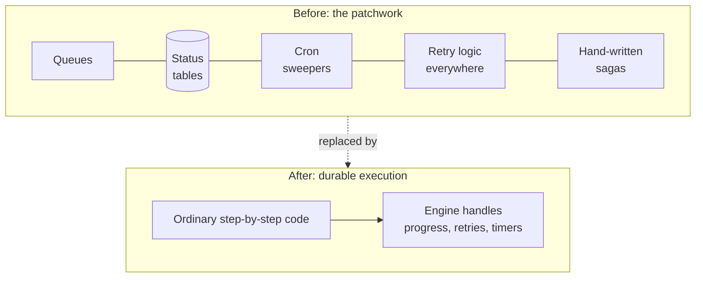

# 1.5 How teams coped before durable execution

**Time:** 15 minutes

Partial failure isn't new. Before durable execution platforms existed, teams solved it with a toolkit of patterns. You'll meet these in customer conversations, often because a customer is **migrating away from them**, so it's worth knowing what they are and why they hurt.

## The status column

Store each order's progress in a database:

| order_id | status | updated_at |
| --- | --- | --- |
| order-1001 | `CHARGED` | 10:04:12 |
| order-1002 | `SHIPPED` | 10:04:15 |

After every step, update the status. After a crash, read the status and resume. It works, but every process now needs its own table, every step needs an extra database write, and the logic for "resume from status X" is hand-written for every process and every status.

## Queues

Put each step's work in a message queue (RabbitMQ, SQS, Kafka). A worker takes a message, does the step, and puts the next step's message on the queue. If the worker crashes, the message goes back on the queue for another worker.

It's resilient, but the process is now scattered across many small handlers. Nobody can read the whole flow in one place, and "where is order 1001 right now?" becomes a detective story.

## The sweeper (cron job)

A scheduled job runs every few minutes, finds records stuck in some status for "too long," and kicks them. Every team writes one, and every team has an incident where the sweeper and the original process both acted on the same order at once.

## Hand-written sagas

When step 3 fails permanently, steps 1 and 2 must be undone: release the inventory, refund the charge. Teams write this "compensation" logic by hand, and it has its own partial failures (what if the refund fails?).

## What it adds up to

The patchwork works, but the reliability logic ends up bigger than the business logic, spread across many systems, and different in every team. Incidents often come from the glue, not the business logic.

## The promise of durable execution

Durable execution makes one bold claim:

> **Write the process as ordinary, top-to-bottom code. The platform makes it survive crashes, restarts and deploys.**

No status tables, no sweepers, no hand-built resume logic. The process reads like the three-line checkout from lesson 1.1, and it behaves as if it never crashed.

Module 2 shows how that's possible by building it yourself.

> **🎧 Support angle**
> Customers migrating from queues and status tables often carry old assumptions with them, like "we need our own retry loop around this call" (now you have two layers of retries) or "we'll track status in our database too" (now there are two sources of truth that can disagree). Spotting these is a big part of onboarding support.
