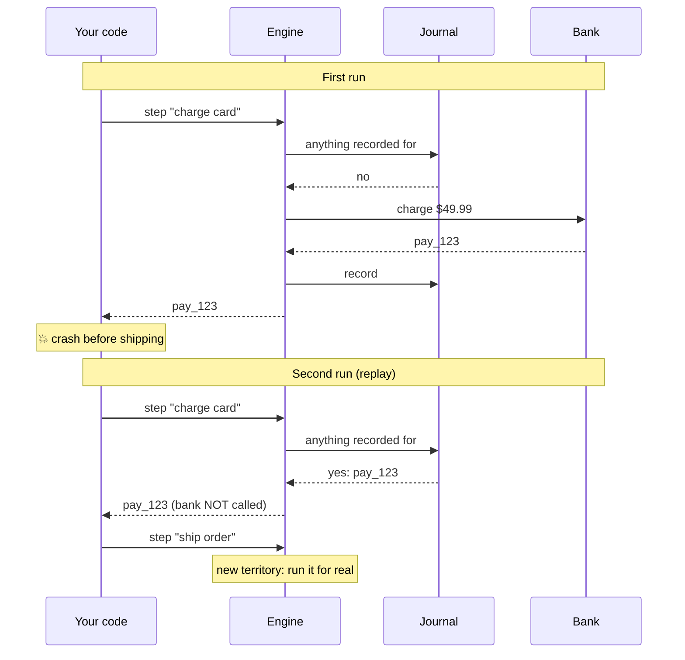

# 2.1 The big idea

**Time:** 10 minutes

Module 1 ended with a wish: *after a crash, the rerun should know how far the last run got.* Durable execution grants that wish with one simple rule.

## Write it down before moving on

> **Every time a step finishes, write down its result. After a crash, run the code again from the top, and for every step that's already written down, use the recorded result instead of doing the step again.**

That's it. Everything else in this course is detail on top of that sentence.

The written record is called the **journal**. Temporal calls it the **event history**; same idea. Using the journal to fast-forward through finished steps is called **replay**.



## Try it

<!-- widget: sim {"mode":"replay","scenario":"crash-after-charge","hint":"First, press ▶ Play the scenario: the order runs, crashes right after the card is charged, and restarts. Watch the highlighted journal entries: those steps are replayed, not re-run. Then press Reset and drive it yourself: crash at different moments and see what each restart does."} -->

*(In the interactive course: a simulator lets you play a crash-and-restart scenario, then crash the order wherever you like and watch which steps run and which are replayed.)*

## Why this is clever

Notice what the **developer** writes:

```ts
await ctx.step("reserve inventory", () => inventory.reserve(orderId, "SKU-42"));
await ctx.step("charge card",       () => bank.charge(orderId, 4999));
await ctx.step("ship order",        () => shipping.ship(orderId, address));
```

It's the three-line checkout from Module 1, with each side effect wrapped in `ctx.step(...)`. No status columns, no resume logic, no "if already charged, skip." The code doesn't know whether it's running for the first time or the tenth. The engine handles that.

`ctx` stands for **context**: the engine's handle, passed into your code. You'll see `ctx` in Restate code exactly like this. Temporal's equivalent looks a little different (Module 4), but the idea is the same.

## The plan for this module

You'll build the engine yourself, one idea per version, and break each version to see why the next one is needed:

| Lesson | Engine | Adds | Fixes |
| --- | --- | --- | --- |
| 2.2 | v1 | The journal | Nothing yet: it records but doesn't use the record |
| 2.3 | v2 | Replay | Crashes between steps |
| 2.4 | v2 | (nothing new) | Shows the gap replay can't close |
| 2.5 | v3 | Idempotency keys | Crashes in the middle of a step |
| 2.6 | v4 | Retries + permanent errors | Transient failures, lost responses |
| 2.7 | v5 | Determinism checks | Code that behaves differently on replay |
| 2.8 | v6 | Durable timers | Waiting that survives crashes |

All engine code lives in [`modules/02-core-ideas/engine/`](../engine/). Each file is short, heavily commented, and marks what's **NEW** compared to the previous version.
