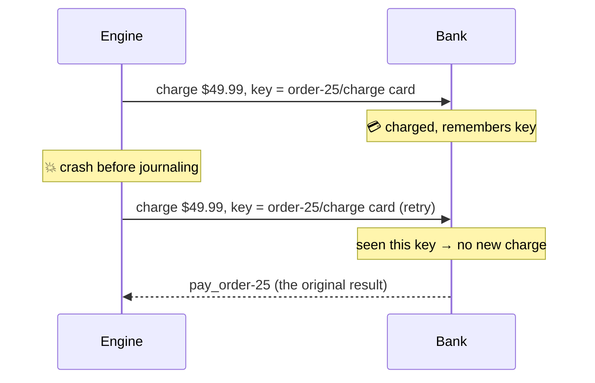

# 2.5 Idempotency keys

**Time:** 20 minutes · **Engine:** [`v3-idempotency.ts`](../engine/v3-idempotency.ts)

## A word worth learning

**Idempotent** (eye-dem-POH-tent) describes an operation you can do twice with the same effect as doing it once.

- Pressing an elevator's call button: idempotent. Pressing it five times doesn't summon five elevators.
- Setting a thermostat to 70°: idempotent.
- "Add $50 to the account": **not** idempotent. Do it twice and it's $100.
- "Charge this card $49.99": **not** idempotent, unless…

## Idempotency keys

Most payment APIs (Stripe, Adyen, PayPal and many others) let you attach a unique **idempotency key** to a request. The provider remembers keys it has seen. If the same key arrives again, it doesn't charge again: it returns the result of the original request.



The step ran twice; the customer was charged once.

## Where does the key come from?

The key must be **the same every time this step runs for this order, and different for everything else.** Engine v3 builds it from two things that never change:

```ts
const idempotencyKey = `${this.workflowId}/${name}`;  // "order-25/charge card"
```

A random key or a timestamp would be useless: the retry would get a *different* key, and the bank would treat it as a new charge.

## The two halves

<!-- widget: sim {"mode":"idempotent","scenario":"crash-during-charge"} -->

This is the most important pairing in the course:

> **Durable execution** guarantees each step's result is recorded once and the workflow never loses its place.
> **Idempotency** guarantees that the occasional repeated step doesn't repeat its effect.
> **Together** they give you *effectively exactly once*.

Neither half works alone:

| | No idempotency key | With idempotency key |
| --- | --- | --- |
| **Plain code** | Duplicates on every rerun | Rerunning is safe, but the process still forgets where it was |
| **Durable execution** | Rare duplicates (crash mid-step) | ✅ Effectively once |

## What if the outside system doesn't support keys?

Not every API does. The options, roughly in order of preference:

1. **Check before acting.** "Has an order with this id already been shipped?" Only works if the check is reliable.
2. **Make the action naturally idempotent.** "Set the status to shipped" instead of "add a shipment."
3. **Put a deduplication table in front of it.** Your own record of keys you've used.
4. **Accept the rare duplicate and handle it afterwards**, like refunding duplicate charges found by a nightly reconciliation job.

> **▶ Run it**
> ```bash
> npm run m2 -- 2.5
> ```
> The ledger will show "bank ignored 1 duplicate request". That's the idempotency key at work.

> **🎧 Support angle**
> "Durable execution double-charged my customer" almost always means a side effect without an idempotency key, interrupted mid-step. The diagnostic questions: Which step? Does the API they call accept an idempotency key? Are they passing a **stable** one (not a random or time-based one)? Module 6 has a full incident on this.
