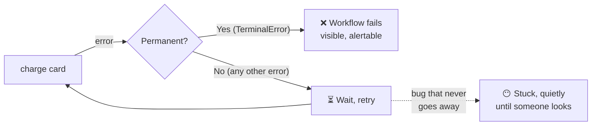

# 2.6 Retries and permanent failures

**Time:** 20 minutes · **Engine:** [`v4-retries.ts`](../engine/v4-retries.ts)

## Moving retries into the engine

In Module 1, retry logic was written by hand inside the checkout. Engine v4 moves it into `ctx.step`, so **every** step gets retries without the workflow code changing at all:

```ts
for (let attempt = 1; ; attempt++) {
  try {
    result = await fn({ idempotencyKey, attempt });
    break;                                          // success: stop retrying
  } catch (err) {
    if (err instanceof PermanentError) throw …;     // never retry these
    if (attempt >= retry.maxAttempts) throw …;      // give up eventually
    await sleep(retry.initialDelayMs * 2 ** (attempt - 1));  // 200ms, 400ms, 800ms…
  }
}
```

## Three experiments

<!-- widget: retry-timeline -->

**A) The bank is down for a moment.** Two `503` errors, then success. The engine waits 200ms, then 400ms, then succeeds. The workflow never noticed.

**B) The lost response.** The bank charges, the reply is lost, the engine retries. In Module 1 this charged twice. Now the retry carries the **same idempotency key** (it's derived from the order id and step name, which don't change between attempts), so the bank ignores the duplicate. **Retries are only safe because of idempotency.**

**C) The card is declined.** Retrying can't change the answer, so v4 stops immediately and marks the workflow **failed**.

## Transient vs. permanent

The engine has to decide, for every error, whether to retry. That's a decision only the **developer** can make, because only they know what each error means. Every engine gives them a way to say "this one is final":

| | Mini engine | Restate | Temporal |
| --- | --- | --- | --- |
| "Don't retry this" | `throw new PermanentError(…)` | `throw new TerminalError(…)` | `ApplicationFailure.nonRetryable(…)`, or list error types in the retry policy |
| Default for any other error | Retry with backoff | Retry with backoff | Retry with backoff |

The default matters: **unless told otherwise, real engines keep retrying errors for a long time.** That's a deliberate choice: it's safer to keep trying and let a human look than to silently give up on a customer's order. The two platforms differ in what "a long time" means:

| Default | Restate (server 1.8) | Temporal |
| --- | --- | --- |
| Retries | Up to 70 attempts, delays starting at 500ms, doubling, capped at 1 minute (roughly an hour in total) | Activities retry with no attempt limit, delays starting at 1s, doubling, capped at 100s |
| When retries run out | The invocation is **paused**: it stops retrying and waits for a human to fix the cause and resume it | Not applicable by default (it never runs out) |
| Configurable? | Yes, per server, service or handler | Yes, per activity |

Either way, a step that keeps failing creates a classic failure mode…

## The stuck workflow

A step that can **never** succeed (a bug, a bad input, a wrong API key) but throws an ordinary error gets retried over and over. Backoff grows, so it doesn't hammer anything, but the workflow is stuck at that step: in Temporal indefinitely, in Restate until it pauses. Either way, unless someone has set up alerting, nobody notices.



> **🎧 Support angle**
> "My workflow has been running for 3 days and nothing's happening" is the stuck-workflow ticket. The first thing to look at is the retry count and the last error on the step (Restate: `restate invocations describe`; Temporal: the pending activity's attempt count and last failure). Fixes: deploy a code fix (the next retry picks it up, or in Restate, resume the paused invocation), mark the error as terminal, or tune the retry policy. Module 6 reproduces this.

## What about the failed order's inventory?

Experiment C left inventory reserved for an order that will never complete. Undoing earlier steps when a later one fails permanently is called a **saga**, and the undo steps are **compensations** ("release inventory", "refund"). Durable execution makes sagas much easier, because the compensations themselves are durable steps that can't be forgotten halfway. You'll build one in Module 3.

> **▶ Run it**
> ```bash
> npm run m2 -- 2.6
> ```
