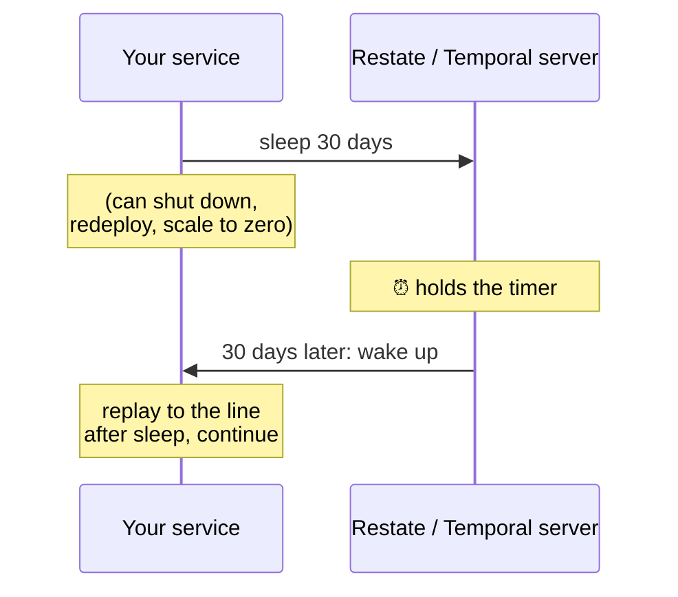

# 2.8 Durable timers

**Time:** 15 minutes · **Engine:** [`v6-timers.ts`](../engine/v6-timers.ts)

## Business processes wait

- Wait for warehouse pickup, then ship
- Send a reminder if the cart is abandoned for 1 hour
- Cancel the reservation if it's unpaid after 24 hours
- Charge the subscription again in 30 days

An ordinary timer (`setTimeout` in JavaScript) lives in memory. Crash, and the timer is gone: the reminder never sends, or the wait starts over from zero after a restart.

## A timer is just another step

Engine v6 adds `ctx.sleep(name, ms)`. The trick is to journal **when to wake up**, not how long to wait:

```ts
async sleep(name, ms) {
  const wakeAt = await this.step(`timer: ${name}`, async () => Date.now() + ms);  // journaled once
  const remaining = wakeAt - Date.now();
  if (remaining > 0) await realSleep(remaining);   // on replay: only what's left
}
```

| What happened | What the replay does |
| --- | --- |
| Crashed 1.5s into a 6s wait, restarted 2s later | Waits the remaining ~2.5s |
| Crashed, restarted after the deadline passed | Continues immediately |
| Never crashed | Waits the full 6s |

Notice that the wake-up time itself comes from `Date.now()`, which lesson 2.7 said was dangerous. It's fine here because it's computed **inside a step**, so it's journaled once and replayed after that.

> **▶ Run it**
> ```bash
> npm run m2 -- 2.8
> ```

## What real engines add: nobody needs to stay awake

The mini engine still keeps a process running during the wait. That's fine for 6 seconds and absurd for 30 days.

Restate and Temporal move the timer to the **server**. While a workflow sleeps, your code doesn't need to be running at all. Your service can be scaled to zero, redeployed or moved. When the timer fires, the server wakes the workflow up and replays it to the line after the sleep.



This is called **suspension**, and it's what makes durable execution practical for long-running processes. It's also why incident 6.1 works: the Restate server held the warehouse timer while the service was dead.

> **🎧 Support angle**
> Timer questions customers ask: "Will my timer still fire if I deploy?" (Yes.) "If my service is down when the timer fires, is it lost?" (No: the server retries until the service is back, then the workflow continues.) "Why did my timer fire late?" (It can't fire until a service is available to run the code. Check for an outage or backlog around that time.)
