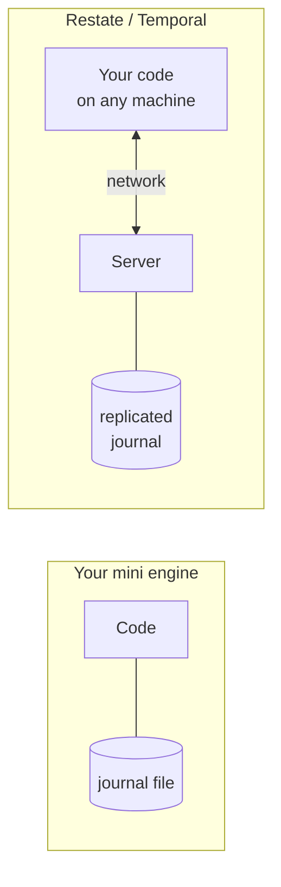

# 2.9 From toy to real

**Time:** 15 minutes

You've built a working durable execution engine: journal, replay, idempotency keys, retries with backoff, terminal errors, determinism checks and durable timers. That's the conceptual core of Restate and Temporal. This lesson covers what separates your ~150-line engine from a production platform. Each gap is something Modules 3–6 cover.

## Where does the journal live?

The mini engine keeps the journal in a file next to the code. If that machine's disk dies, the journal goes with it, and so does every in-flight order.

Real platforms keep the journal in a **separate server**, replicated across machines:

That separation is what lets your code crash, scale up and down, or move between machines freely: the server is the source of truth.

## Who starts the work: push or pull?

Once the journal is on a server, someone has to connect the server and your code. Restate and Temporal made **opposite choices**, and it shapes almost everything about how they behave and how they break:

| | Restate: **push** | Temporal: **pull** |
| --- | --- | --- |
| How it works | The server calls your service over HTTP when there's work | Your workers ask the server for work ("polling a task queue") |
| Your code looks like | A web service, or a serverless function | A long-running worker process |
| When your code is down | The server records connection errors and retries | Work waits in the queue; nothing errors |

You'll see this difference in nearly every module from here on.

## The rest of the gap

| Capability | Mini engine | Real platforms | Module |
| --- | --- | --- | --- |
| Survive machine loss | ❌ | ✅ replicated storage | 3, 4 |
| Run many workflows at once | Kind of | ✅ thousands per second | 6 |
| Sleep without a running process | ❌ | ✅ suspension | 3, 4 |
| Call other workflows / services durably | ❌ | ✅ | 3, 4 |
| Wait for outside events ("payment approved") | ❌ | ✅ signals, awakeables, promises | 3, 4 |
| Durable state per entity ("this customer's cart") | ❌ | ✅ (Restate built in; Temporal differently) | 3, 4 |
| Inspect a running workflow | Open the JSON file | ✅ CLI, web UI, SQL | 3, 4 |
| Change code safely under running workflows | ❌ | ✅ versioning tools | 6 |
| Metrics, tracing, alerts | ❌ | ✅ | 6 |

## You're ready

If you can explain these to someone else, you understand durable execution:

1. **Journal:** each step's result is written down before moving on.
2. **Replay:** after a crash, rerun from the top, reusing recorded results.
3. **At-least-once:** a step interrupted mid-flight runs again. No engine can avoid that alone.
4. **Idempotency:** stable keys make that repeat harmless. Engine plus idempotency gives effectively once.
5. **Retries:** transient errors are retried with backoff; terminal errors stop. Default is to keep retrying.
6. **Determinism:** replayed code must ask for the same steps in the same order. Randomness, time and changing code break it.
7. **Durable timers:** journal the wake-up time; real servers hold the timer so nothing has to stay running.

Write those seven in your own words in your learning log before starting Module 3. If one is fuzzy, rerun its lesson.
