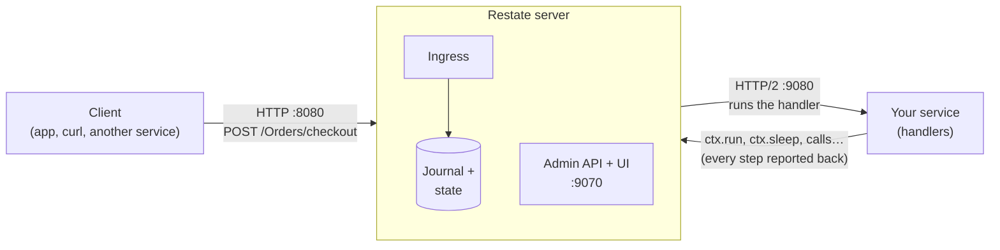

# 3.1 How Restate works

**Time:** 20 minutes

You built a durable execution engine in Module 2. Restate is a production version of the same ideas, made by the team that created Apache Flink, a widely used stream-processing system. This lesson maps what you know onto Restate's pieces.

## Three pieces

| Piece | What it does | In this course |
| --- | --- | --- |
| **Restate server** | Receives requests, keeps every invocation's journal and every object's state, holds timers, retries, and calls your code. A single binary. | `npm run restate` (ports 8080, 9070) |
| **Your service** | Ordinary code with handlers, using the Restate SDK. Restate calls it over HTTP. It can run anywhere: a container, a VM, or a serverless function. | `npm run shop` (port 9080) |
| **Clients** | Anything that sends HTTP requests to Restate's port 8080. They never call your service directly. | `curl`, the lesson scripts |

## Restate pushes work to your service

In your mini engine, your code called the engine. Restate is the other way around: **the Restate server calls your service** when there's work to do. This is the "push" model from lesson 2.9.

What happens on one request:

1. A client sends `POST /Orders/checkout` to Restate.
2. Restate records the request as an **invocation** with a new id (`inv_…`) and an empty journal.
3. Restate calls your service's `checkout` handler, sending along any journal it already has.
4. Each time the handler does something through `ctx` (a `ctx.run`, a call, a sleep), the SDK reports it to Restate, which adds it to the journal.
5. When the handler returns, Restate records the result and answers the client.

If the service crashes at step 4, Restate notices the connection broke and calls the handler again, this time sending the journal so far. The SDK **replays** from it, exactly like engine v2.

## The vocabulary

| Restate term | What it means | Mini-engine equivalent |
| --- | --- | --- |
| **Service** | A group of handlers | The file with your workflow |
| **Handler** | A function Restate can call | `runWorkflow(…)` |
| **Invocation** | One call to a handler, with its own id and journal | One workflow run |
| **Journal** | The recorded steps of an invocation | The journal file |
| **`ctx`** | The handle your code uses for anything durable | `ctx` |
| **`ctx.run`** | Run a side effect once, record the result | `ctx.step` |
| **Deployment** | A registered version of your service at a URL | (none) |
| **Virtual object** | A service with a key and durable per-key state | (none) |
| **Workflow** | A virtual object whose `run` executes once per key | (none) |

## Three kinds of service

You'll use all three in this module:

| Kind | Addressed as | Special powers | Example |
| --- | --- | --- | --- |
| **Service** | `Orders/checkout` | Durable steps, calls, timers | Checkout, payments |
| **Virtual object** | `Cart/dana/add` | Plus: durable state per key; one request at a time per key | Shopping cart, account balance |
| **Workflow** | `Returns/r-1/run` | Plus: `run` executes once per key; other handlers can signal it while it runs | Approvals, signups |

## The shop

Every lesson in this module uses one small online shop in [`modules/03-restate/shop/`](../shop/):

| File | Service | Lesson |
| --- | --- | --- |
| `greeter.ts` | Greeter (hello world) | 3.2 |
| `orders.ts` | Orders: reserve, charge, wait, ship | 3.3, 3.4 |
| `payments.ts` | Payments: wraps the bank | 3.4, 3.5 |
| `emails.ts` | Emails | 3.4 |
| `inventory-sync.ts` | InventorySync: a flaky supplier | 3.5 |
| `reminders.ts` | Reminders: long timers | 3.6 |
| `cart.ts` | Cart: a virtual object | 3.7 |
| `returns.ts` | Returns: a workflow | 3.8 |
| `async-payments.ts` | AsyncPayments: webhooks via awakeables | 3.9 |
| `order-saga.ts` | OrderSaga: undo on failure | 3.10 |

The services still talk to the same fake bank, warehouse and carrier from Modules 1 and 2, so you can check the **ledger** after every experiment.

> **🎧 Support angle**
> Customers often picture Restate as "a library inside my app." It isn't: it's a server their app talks to, plus an SDK. Many first tickets ("my service gets requests I didn't send", "why do I need to register a URL?") make sense once a customer sees the push model in this diagram.
