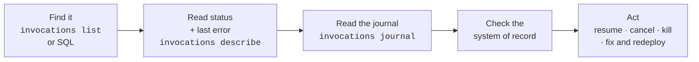

# 3.11 Inspecting everything: CLI, UI and SQL

**Time:** 30 minutes

Everything in this module was observable. This lesson collects the tools into one support toolkit. Practice these until they're second nature: they're what you'll use on almost every Restate ticket.

## The investigation loop



## The CLI

| Command | Use it to |
| --- | --- |
| `restate invocations list` | See what's in flight (add `--all` to include finished ones) |
| `restate invocations describe <id>` | Status, last error, journal summary, and a hint for what to do next |
| `restate invocations journal <id>` | The full journal (`--payload` shows values) |
| `restate invocations resume <id or target>` | Retry a paused or backing-off invocation now. A target like `Orders/checkout` resumes all of that handler's invocations. `--deployment` moves them to another deployment (for example one with a bug fix), if its code takes the same steps. |
| `restate invocations cancel <id>` | Stop gracefully: the handler gets a cancellation error, so sagas can compensate |
| `restate invocations kill <id>` | Stop immediately, **without** compensations. Last resort. |
| `restate services list` / `deployments list` | What's registered, and where |
| `restate state get <Object> <key>` | Read a virtual object's state |
| `restate sql "<query>"` | Anything else |
| `restate search <words>` | Find the right command |

## Invocation statuses

| Status | Meaning | Healthy? |
| --- | --- | --- |
| `pending` / `scheduled` | Waiting to start (queued behind its key, or a delayed send) | Usually |
| `running` | The service is executing it | Yes |
| `suspended` | Waiting on a timer, call, promise or awakeable; no service needed | Yes: `describe` says what it's waiting on |
| `backing-off` | The last attempt failed; retrying after a delay | Look at the last error |
| `paused` | Retries ran out; waiting for a human | Needs action |
| `completed` | Finished, **with success or failure** | Check `completion_result` |

## SQL

Restate exposes its internals as SQL tables. A few queries cover most investigations:

```sql
-- What failed for good, and why?
SELECT id, target, completion_failure
FROM sys_invocation WHERE completion_result = 'failure';

-- Load by handler and status
SELECT target, status, count(*) FROM sys_invocation GROUP BY target, status;

-- One invocation's journal
SELECT index, entry_type, name FROM sys_journal WHERE id = 'inv_…' ORDER BY index;

-- Virtual object state
SELECT service_name, service_key, key, value_utf8 FROM state;
```

`npx restate sql --help` lists every table.

**For work that's still retrying, use the CLI, not SQL.** Between attempts, the `status` column can briefly read `ready` instead of `backing-off`, so a SQL filter on `'backing-off'` misses invocations. `restate invocations list` always shows them as `backing-off (retry N)`, and `describe` shows the last error.

## The UI

The Restate server includes a web UI at **http://localhost:9070/ui**: invocations, journals, state, services and deployments, clickable. It's the friendliest view for customers who aren't comfortable in a terminal, so learn your way around it too.

> **▶ Run it**
> ```bash
> npm run m3 -- 3.11
> ```
> The lesson generates a mix of good and failed orders, then walks through each tool. It keeps the server running at the end so you can open the UI.

> **🎧 Support angle**
> A ticket that says "my workflow is broken" and nothing else is common. The fastest path to an answer: ask for the invocation id (or find it with SQL by target and time), then `describe`. Status plus last error plus last journal entry answers most tickets before you need any more information from the customer.
