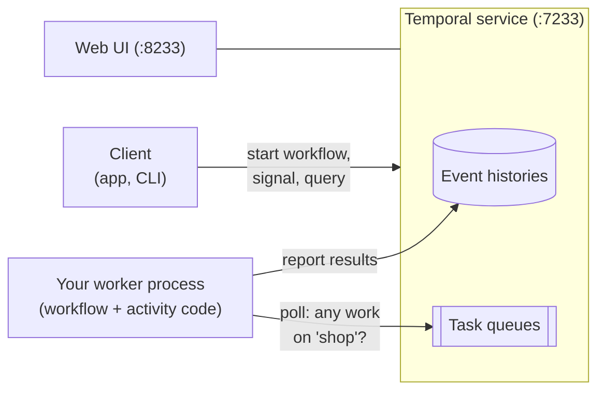

# 4.1 How Temporal works

**Time:** 25 minutes

> **Status: being verified.** This module's code type-checks and its workflows build with Temporal's own bundler, but the hands-on lessons haven't yet been confirmed end to end against a live Temporal server. If a lesson doesn't behave as described, please open an issue with the lesson number and the terminal output.

Temporal is the largest company in durable execution. It grew out of Cadence, a system built at Uber, and its open-source server and managed Temporal Cloud are used by thousands of companies. It implements the same core ideas as your mini engine and Restate, with a different architecture. This module rebuilds the Restate shop on Temporal so you can feel the differences.

## The pieces



| Piece | What it does | In this course |
| --- | --- | --- |
| **Temporal service** | Stores every workflow's event history, holds timers, and puts work on task queues. In production it's a cluster of services plus a database; for development, the Temporal CLI includes a single-process dev server. | `npm run temporal` |
| **Worker** | A long-running process **you run**. It polls a task queue, executes your workflow and activity code, and reports results. | `npm run worker` |
| **Client** | Starts workflows, sends signals, runs queries, reads results. Your app, the CLI, or a script. | the lessons, `temporal` CLI |

## Your workers pull work from Temporal

Restate **pushes** work to your service by calling it. In Temporal, nothing calls your code: your workers **pull** work by repeatedly asking a **task queue**, "anything for me?"

This one difference explains a lot:

| | Restate (push) | Temporal (pull) |
| --- | --- | --- |
| Your code is | A service Restate can reach by URL | A worker that can reach Temporal |
| Network direction | Restate → your service | Your worker → Temporal (works from behind firewalls) |
| When your code is down | Restate records connection errors and retries | Work waits on the queue, **silently** |
| Scaling | Restate spreads requests across deployments | Start more workers on the same task queue |
| Serverless fit | Natural (Lambda, Cloudflare Workers…) | Workers are long-lived processes (Temporal has been adding serverless options) |

## Workflows and activities

Temporal splits your code in two:

| | **Workflow** | **Activity** |
| --- | --- | --- |
| Is | The orchestration: steps, order, waiting | One side effect: an API call, a database write, an email |
| Must be | **Deterministic**: replayed from history | Anything goes |
| Runs | In a sandbox inside the worker | As a plain function in the worker |
| On failure | A bug pauses the workflow task (4.5) | Retried by its retry policy |
| Restate equivalent | The handler body | `ctx.run(…)` |

In Restate, side effects live *inside* the handler as `ctx.run` blocks. In Temporal, they live in *separate functions* that the workflow calls through a proxy:

```ts
// activities.ts: plain functions
export async function chargeCard(orderId: string, amountCents: number) { … }

// workflows.ts: only the TYPE is imported, never the code
import type * as activities from "./activities.js";
const acts = proxyActivities<typeof activities>({ startToCloseTimeout: "10 seconds" });

export async function checkout(order: Order) {
  await acts.chargeCard(order.orderId, order.amountCents);   // schedules an activity
}
```

## The vocabulary

| Temporal | Means | Restate | Mini engine |
| --- | --- | --- | --- |
| Workflow Execution | One run of a workflow, identified by a **workflow id** | Invocation | Workflow run |
| Event History | The recorded events of an execution | Journal | Journal |
| Activity | A side-effecting function | `ctx.run` | `ctx.step` |
| Workflow Task | The worker running workflow code to decide the next step | (replay inside a handler call) | (none) |
| Task Queue | Where workers pick up work | (none: push) | (none) |
| Signal / Query / Update | Send data in / read state / send and get a reply | Handler calls, durable promises | (none) |
| Namespace | An isolated tenant within a Temporal service | (none) | (none) |

## The shop, again

[`modules/04-temporal/shop/`](../shop/) mirrors the Restate shop:

| File | What's in it |
| --- | --- |
| `activities.ts` | Every side effect: reserve, charge, refund, ship, email, the flaky supplier |
| `workflows.ts` | checkout, inventorySync, reminder, cart, returnRequest, asyncPayment, orderSaga, giftOrder, printLabel, batchCheckout |
| `workflows-changed.ts`, `workflows-patched.ts` | Two later versions of `giftOrder`, for lesson 4.10 |
| `worker.ts` | The worker process |

> **🎧 Support angle**
> The single most common Temporal question is some form of "I started a workflow and nothing happens." With the pull model, the usual answer is that no worker is polling that task queue: wrong queue name, wrong namespace, the worker crashed, or it never started. You'll reproduce this in lesson 4.4.
