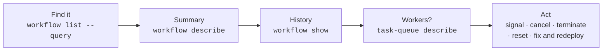

# 4.11 Inspecting everything: CLI and Web UI

**Time:** 25 minutes

## The investigation loop

Same loop as Restate (lesson 3.11), different tools:



## The CLI

| Command | Use it to |
| --- | --- |
| `temporal workflow list` | List executions (`--query` to filter, `--limit` to cap) |
| `temporal workflow count --query …` | Count matching executions |
| `temporal workflow describe -w <id>` | Status, task queue, pending activities with attempts and last failure, pending workflow task |
| `temporal workflow show -w <id>` | The full event history (`--output json` to save it for replay tests) |
| `temporal task-queue describe --task-queue <name>` | Which workers are polling |
| `temporal workflow signal -w <id> --name <signal> --input '<json>'` | Send a signal |
| `temporal workflow query -w <id> …` | Run a query (check `--help` for the flag that names the query in your CLI version) |
| `temporal workflow cancel -w <id>` | Ask the workflow to cancel; it can clean up (compensate) |
| `temporal workflow terminate -w <id> --reason …` | Stop immediately; no cleanup runs. Last resort. |
| `temporal workflow reset -w <id> …` | Rewind a workflow to an earlier point in its history and re-run from there |

## Visibility queries

`--query` uses a SQL-like filter over **search attributes**:

```bash
temporal workflow list --query "ExecutionStatus = 'Running'"
temporal workflow list --query "WorkflowType = 'checkout' AND ExecutionStatus = 'Failed'"
temporal workflow list --query "WorkflowId STARTS_WITH 'cart-'"
temporal workflow count --query "WorkflowType = 'checkout'"
```

Teams can add **custom search attributes** (customer id, order total…) so support can find workflows by business data.

Compare Restate's `restate sql`: Restate exposes its internals as SQL tables, including journals and state; Temporal exposes a filtered list of executions, and you open each one for its history.

## The Web UI

http://localhost:8233 (or Temporal Cloud's UI). Spend time here. Most customers live in the UI rather than the CLI:

- **Workflows list** with filters (the same query language)
- **Workflow page**: summary, input and result, pending activities, the event history in list, compact and timeline views, and **stack trace** (what the workflow is currently waiting on)
- **Task queue page**: pollers and their last access time

> **▶ Run it**
> ```bash
> npm run m4 -- 4.11
> ```

## Status quick reference

| Status | Meaning |
| --- | --- |
| Running | In progress. Healthy, or stuck: check pending activities and workflow tasks. |
| Completed | Returned a result |
| Failed | Ended with a failure (non-retryable error, or out of retries/time) |
| Canceled | Cancelled, and handled the cancellation |
| Terminated | Stopped from outside, or by a history limit |
| ContinuedAsNew | This run ended; a new run with the same id continues |
| TimedOut | Hit a workflow-level timeout |

> **🎧 Support angle**
> For "my workflow is stuck," `describe` is again the fastest first step: a **pending activity** with a high attempt count and a last failure means a failing activity; a **pending workflow task** with failures means a workflow-code bug or non-determinism; a pending task with no failures and no pollers means no worker.
