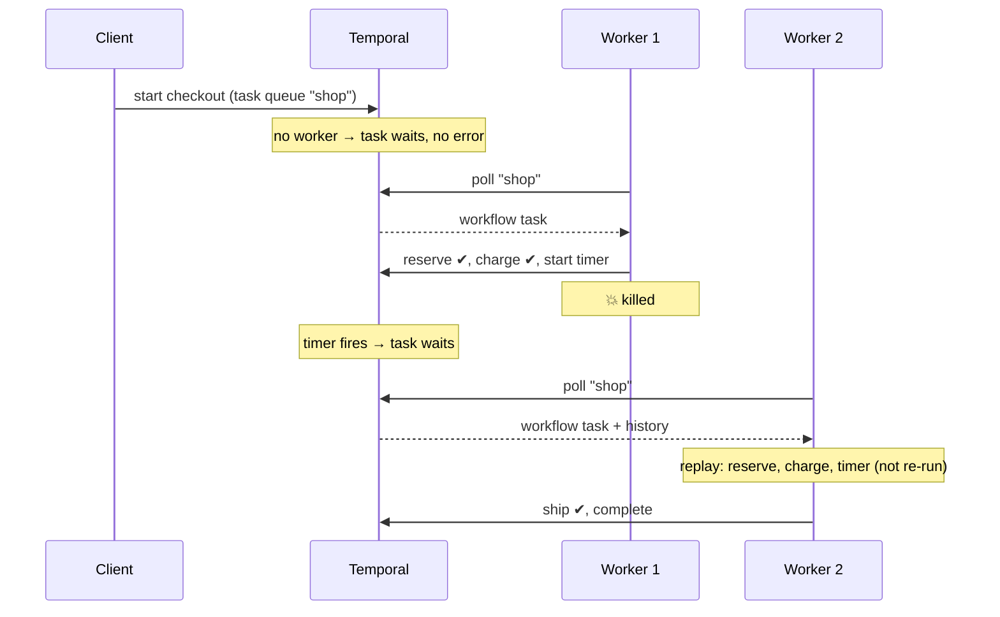

# 4.4 Workers and task queues

**Time:** 25 minutes

## Work waits for a worker

When you start a workflow, Temporal records `WorkflowExecutionStarted` and puts a **workflow task** on the task queue you named. Nothing else happens until a worker polling that queue picks it up. The same goes for every activity and every step after a timer fires.

This lesson starts a checkout with **no worker running**:

```
Status          Running
Pending workflow task: Scheduled
```

There's no error, and nothing anywhere says something is wrong. The work is just waiting. The tell:

```bash
temporal task-queue describe --task-queue shop
```

shows **no pollers**. Start a worker, and the waiting work is picked up within a second.

## Crashing the worker

Then the lesson kills the worker in the middle of the 8-second pickup timer. The workflow stays `Running`; the server holds the timer. When it fires, the next workflow task waits on the queue until a worker returns. The new worker **replays** the history (the activities already done are not re-run) and carries on.



> **▶ Run it**
> ```bash
> npm run m4 -- 4.4
> ```

## Scaling and routing

- **More workers = more throughput.** Run more copies of the worker on the same task queue; they share the work. No load balancer needed.
- **Task queues route work.** Activities can run on a different queue from their workflow, for example GPU workers for an AI step or workers inside a specific network for a database call.
- **A task queue exists as soon as something uses its name.** A typo doesn't produce an error: it creates a different, empty queue that no worker polls.

## The "nothing is happening" checklist

| Check | How |
| --- | --- |
| Is any worker polling the task queue? | `temporal task-queue describe --task-queue <name>`, or the Task Queue page in the UI |
| Same task queue name in the client and the worker? | Compare the workflow's task queue in `describe` with the worker's config |
| Same **namespace**? | Workers and clients both name a namespace; a mismatch looks exactly like "no worker" |
| Is the worker registered with this workflow type? | A worker that doesn't know the type fails the workflow task with an error saying so |
| Is the worker healthy but overloaded? | Many pending tasks with pollers present: add workers, or raise their concurrency settings |

> **🎧 Support angle**
> Compare lesson 3.3. Restate tells you loudly when your service is down: "connection refused", with retry counts. Temporal's silence when no worker is polling is by design, because a queue holding work is normal, but it's the root of many "Temporal is stuck" tickets. Asking "which task queue, and is anything polling it?" first will resolve a large share of them.
