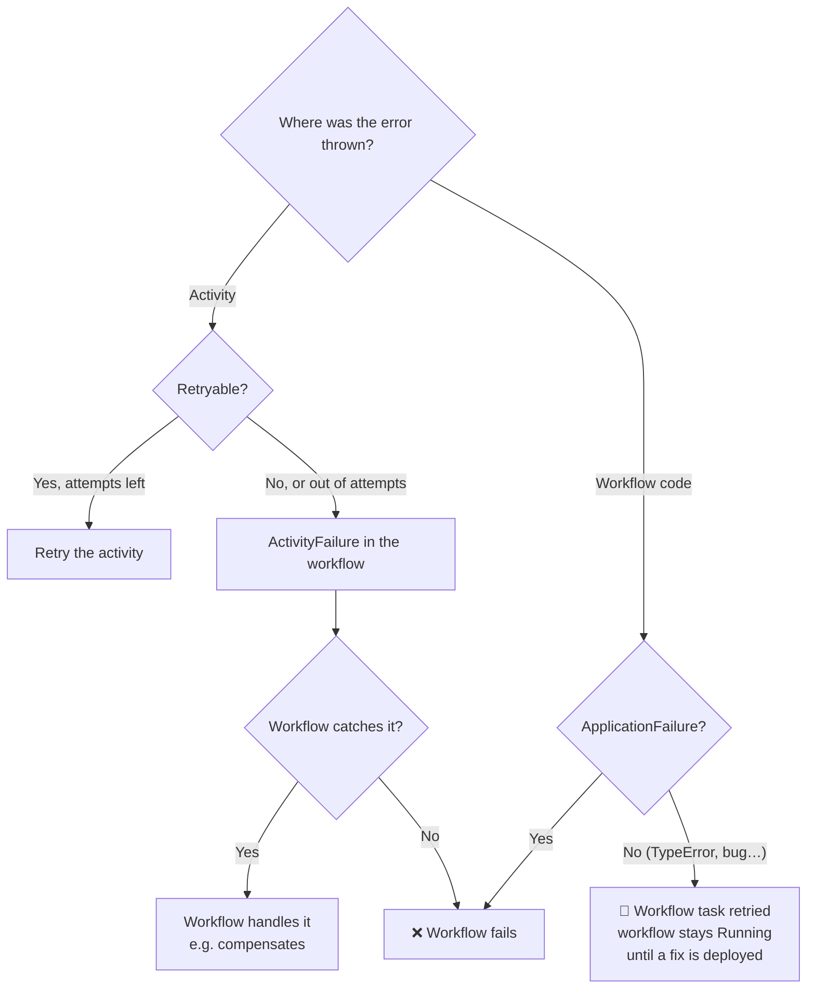

# 4.5 Retries, timeouts and failures

**Time:** 35 minutes · **Code:** [`shop/activities.ts`](../shop/activities.ts), [`shop/workflows.ts`](../shop/workflows.ts)

## Activity retries

Every activity has a **retry policy**. If you don't set one, Temporal's default retries **forever**, starting at 1 second, doubling, capped at 100 seconds. The shop sets its own:

```ts
retry: { initialInterval: "500 milliseconds", backoffCoefficient: 2, maximumInterval: "10 seconds" }
```

| Field | Means |
| --- | --- |
| `initialInterval` | Wait before the first retry |
| `backoffCoefficient` | Multiply the wait by this after each failure |
| `maximumInterval` | Never wait longer than this between attempts |
| `maximumAttempts` | Give up after this many attempts (default: unlimited) |
| `nonRetryableErrorTypes` | Error types that should never be retried |

## Activity timeouts

Temporal makes you think about time explicitly. The ones you'll meet:

| Timeout | Limits | Typical use |
| --- | --- | --- |
| `startToCloseTimeout` | One attempt, from pick-up to finish | Always set: "an attempt taking longer than this has failed" |
| `scheduleToCloseTimeout` | All attempts together, including retries and waiting | "Give up on this step entirely after 1 hour" |
| `heartbeatTimeout` | Time between heartbeats from a long activity | Long jobs call `heartbeat()` so a crashed worker is detected quickly |

A timed-out attempt counts as a failure and is retried like any other.

## Four experiments

> **▶ Run it**
> ```bash
> npm run m4 -- 4.5
> ```

**A) Transient failure.** The bank returns 503 four times. While it's retrying, `temporal workflow describe` shows a **pending activity** with its attempt number and last failure. Then it succeeds. One charge.

**B) Non-retryable failure.** A declined card:

```ts
throw ApplicationFailure.nonRetryable(`Card declined for ${orderId}`, "CardDeclined");
```

This is Temporal's `TerminalError`. The activity fails at once, the failure surfaces in the workflow as an `ActivityFailure`, and since `checkout` doesn't catch it, **the workflow fails**.

**C) Out of attempts.** `inventorySync` allows 4 attempts against a broken supplier. After the 4th, the activity fails and so does the workflow.

> **A real difference:** Restate's default, when retries run out, is to **pause** the invocation for a human (lesson 3.5). Temporal fails the activity and lets the workflow code decide; unhandled, the workflow fails. Temporal's default of *unlimited* activity retries means you only hit this when you set `maximumAttempts`.

**D) A bug in workflow code.** `printLabel` calls `.toUpperCase()` on a gift message that isn't there. Look at what happens:

```
Status: Running
…
  WorkflowTaskStarted
  WorkflowTaskFailed       TypeError: Cannot read properties of undefined
  WorkflowTaskScheduled
  WorkflowTaskStarted
  WorkflowTaskFailed
  …
```

An ordinary error thrown **from workflow code** doesn't fail the workflow. Temporal treats it as a failed **workflow task**, assumes the code is broken, and keeps retrying the task. The workflow stays Running until a fixed version of the code is deployed, then continues from where it was. Only `ApplicationFailure` (and other Temporal failure types) thrown from workflow code fail the workflow itself.

## The two failure paths



> **🎧 Support angle**
> Two classic tickets. "My workflow has been Running for days and nothing's happening": check the history for repeated `WorkflowTaskFailed` (a bug in workflow code) and for a pending activity with a huge attempt count (a failing activity with unlimited retries). "My workflow failed but I didn't want it to": a non-retryable error, `maximumAttempts`, or a `scheduleToCloseTimeout` ran out.
