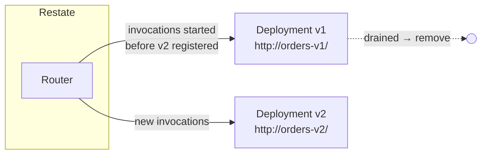

# 7.1 Changing code safely in Restate

**Time:** 30 minutes · **Revisit:** incident 6.3, steps 3 and 4 (`npm run m6 -- 6.3`)

Durable workflows outlive deploys. An order started on Monday's code may still be waiting for pickup when Tuesday's code ships. Every durable execution platform needs an answer to "which code does an in-flight workflow run on?" Restate's answer is **immutable deployments with pinning**.

## The model



1. **Each version is its own deployment** at its own endpoint (URL, Lambda version, …).
2. **Invocations are pinned** to the deployment they started on. Every retry and replay goes to that same code.
3. **New invocations go to the latest** registered deployment for that service.
4. When an old deployment has no active invocations, it's **drained**: remove it and shut it down.

Because of pinning, handlers don't need version checks like Temporal's `patched()`. The cost is operational: you must keep old versions running until they drain.

## The workflow

```bash
# deploy the new code at a new endpoint, then:
restate deployments register http://orders-v2/
restate deployments list                           # v1 now marked "superseded"
restate deployments describe <v1-id> --extra       # active invocations still on v1?
restate deployments remove <v1-id>                 # once drained
```

On serverless platforms (Lambda versions, Cloudflare Workers, Vercel, Deno Deploy) and with Restate's **Kubernetes operator**, this happens automatically: each version gets its own endpoint, and old ones are kept until drained.

## What breaks it

| Action | Result |
| --- | --- |
| `register --force` on the **same** endpoint in production | In-flight invocations move to the new code. Fine for bug fixes inside `ctx.run`; reordered/added/removed steps cause RT0016 journal mismatches (incident 6.3). The CLI warns that this is dangerous. |
| Removing a deployment before it's drained | Its in-flight invocations have nowhere to run |
| Very long-running handlers | Old deployments take a long time to drain. Prefer splitting long processes into steps linked by delayed sends. |
| Renaming or removing a handler | Registration rejects it unless you pass `--breaking`, because callers may still use the old name |
| Changing the shape of virtual object state | State outlives deployments: v2 must read what v1 wrote. Keep state schemas backward compatible. |

## Fixing a bug in invocations that are already running

Sometimes in-flight invocations need **new** code, for example a bug that makes them fail. If the fix doesn't change the sequence of Restate operations (a fix *inside* a `ctx.run`, say), move them to the fixed deployment:

```bash
restate deployments register http://orders-v2-fixed/
restate invocations pause <id>
restate invocations resume <id> --deployment <fixed-deployment-id>
```

If the fix does change the sequence, the old invocations must finish (or be cancelled and re-run) on code that matches their journals.

> **🎧 Support angle**
> Versioning questions are among the most important you'll handle, because mistakes are painful and customers are often unsure what's safe. The key facts: invocations are pinned, `--force` is for local development, drain before removing, and state must stay compatible across versions. Incident 6.3 is the classic failure.
